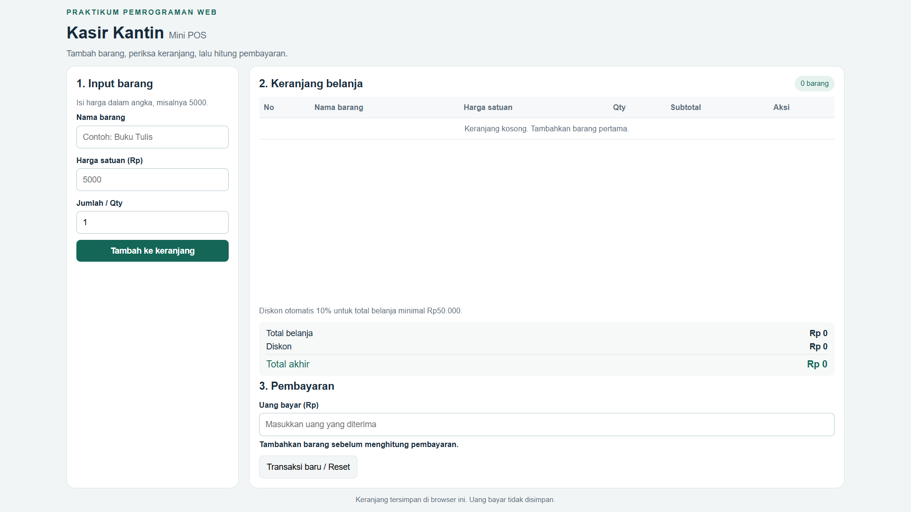
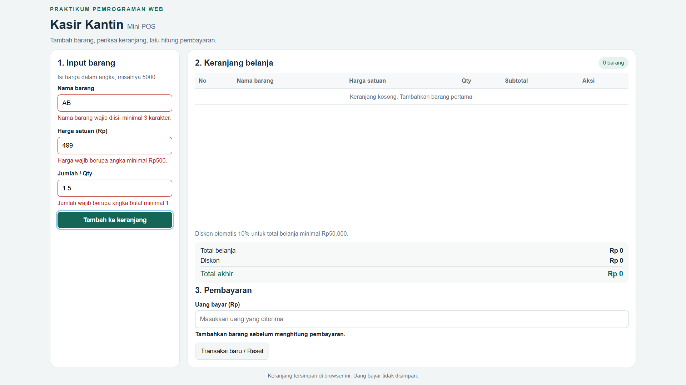
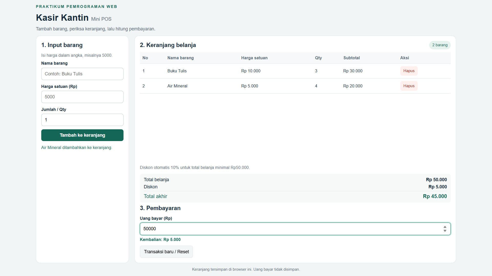

# Mini POS — Kasir Kantin

## Identitas

- Nama: Ridho Maulana Saputra
- NIM: 124140090
- Kelas praktikum: RA

## Deskripsi aplikasi

Aplikasi web kasir sederhana untuk kantin kampus. Kasir memasukkan barang, harga, dan jumlah. Aplikasi memvalidasi input, menampilkan keranjang, menghitung subtotal, diskon, total akhir, dan kembalian secara otomatis. HTML, CSS, dan JavaScript dipisahkan; tidak diperlukan framework atau database.

## Menjalankan

1. Buka folder proyek di VS Code.
2. Gunakan ekstensi Live Server. Klik kanan `index.html`, lalu pilih **Open with Live Server**.
3. Isi form, kemudian klik **Tambah ke keranjang**.
4. Isi **Uang bayar** untuk menghitung kembalian.
5. Refresh pada alamat dan port yang sama untuk memeriksa penyimpanan keranjang.

## Latihan modul

Solusi 21 latihan JavaScript Dasar tersedia di folder `modul/`, dikelompokkan menjadi Variabel & Kondisional, Loop & Fungsi, Array & Objek, serta DOM & API.

Buka [menu latihan](modul/index.html) melalui Live Server. Struktur folder, daftar latihan, dan contoh pengecekan tersedia di [panduan modul](modul/README.md).

## Fitur

- [x] Nama barang wajib diisi, minimal 3 karakter setelah spasi tepi dibuang.
- [x] Harga angka positif minimal Rp500.
- [x] Qty angka bulat minimal 1.
- [x] Pesan merah di bawah input yang salah; data salah tidak masuk keranjang.
- [x] Form kembali ke nilai awal setelah berhasil (Qty kembali ke 1).
- [x] Tabel: No, Nama Barang, Harga Satuan, Qty, Subtotal, Aksi.
- [x] Subtotal dan total belanja dihitung otomatis.
- [x] Diskon otomatis 10% jika total belanja minimal Rp50.000.
- [x] Nominal diskon dibulatkan ke rupiah terdekat.
- [x] Total akhir dan kembalian otomatis; pesan jika uang kurang.
- [x] Hapus barang dan hitung ulang semua nominal.
- [x] Penyimpanan keranjang dengan `JSON.stringify()` dan `JSON.parse()`.
- [x] Transaksi baru mengosongkan keranjang dan menghapus kunci penyimpanan aplikasi.
- [x] Format Rupiah dan layout responsif.

## Alur JavaScript

1. `muatKeranjang()` mengambil teks dari localStorage dan mengubahnya menjadi array objek.
2. Event `submit` membatalkan pemuatan ulang halaman, membaca input, dan memvalidasi data.
3. Data valid masuk ke array melalui `push()`, kemudian disimpan dan ditampilkan ulang.
4. `hitungTotal()` menjumlahkan `harga × qty` menggunakan `reduce()`; diskon berlaku pada total sebelum diskon.
5. `renderKeranjang()` membuat baris tabel dan memperbarui ringkasan.
6. `hitungPembayaran()` menghitung uang bayar dikurangi total akhir setiap input pembayaran berubah.
7. Tombol hapus menggunakan `splice(index, 1)` kemudian menyimpan dan merender ulang.
8. Tombol transaksi baru menggunakan `removeItem()` agar hanya data aplikasi ini yang dihapus.

LocalStorage menyimpan pasangan kunci dan nilai berupa teks. Kunci aplikasi adalah `mini-pos-124140090`. Array diubah menjadi teks JSON ketika disimpan, lalu dikembalikan menjadi array ketika dimuat. Keranjang tersimpan di browser dan origin yang sama; uang bayar tidak ikut disimpan.

## Contoh hitungan

Buku Tulis Rp10.000 × 3 = Rp30.000. Air Mineral Rp5.000 × 4 = Rp20.000. Total Rp50.000; diskon Rp5.000; total akhir Rp45.000. Jika uang bayar Rp50.000, kembalian Rp5.000. Jika uang bayar Rp40.000, kekurangan Rp5.000.

## Tangkapan layar

### 1. Form input utama

### 2. Validasi error

### 3. Keranjang dan hasil perhitungan

