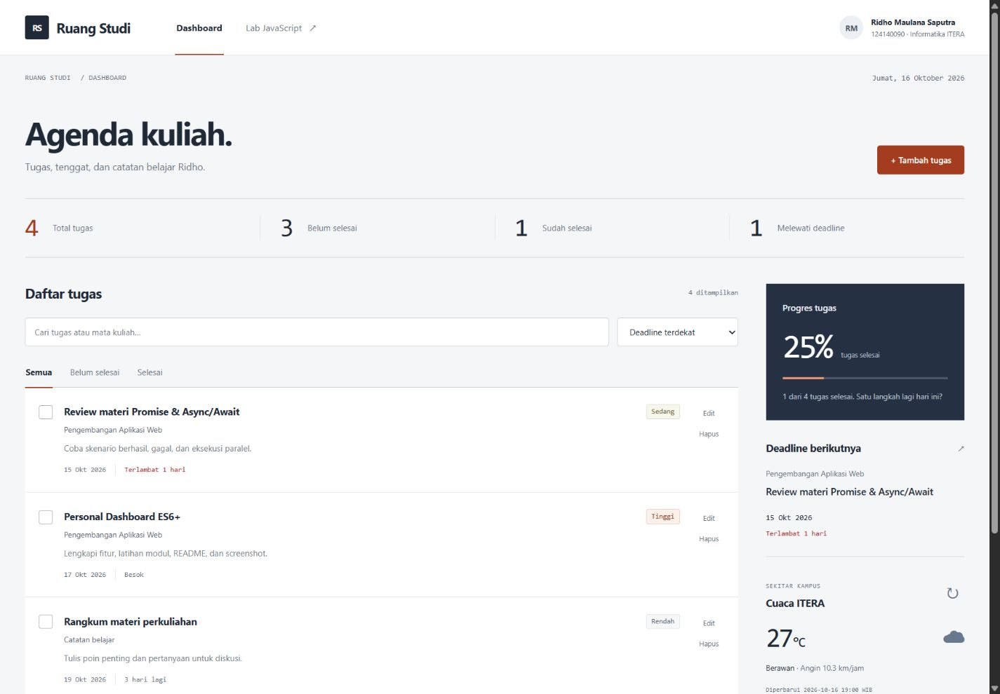
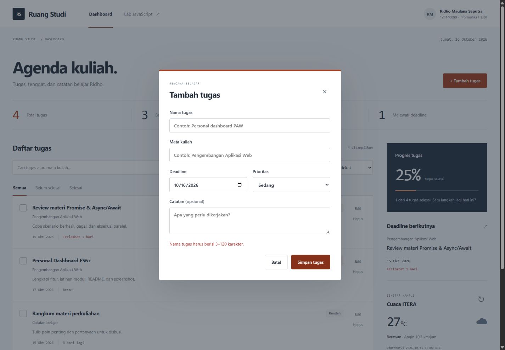
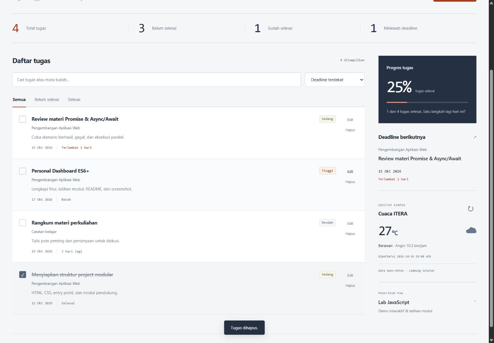
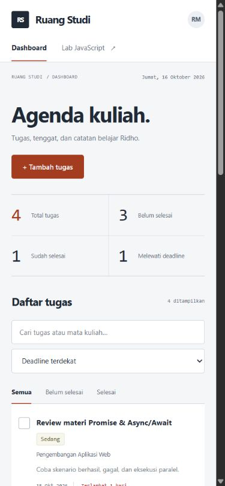
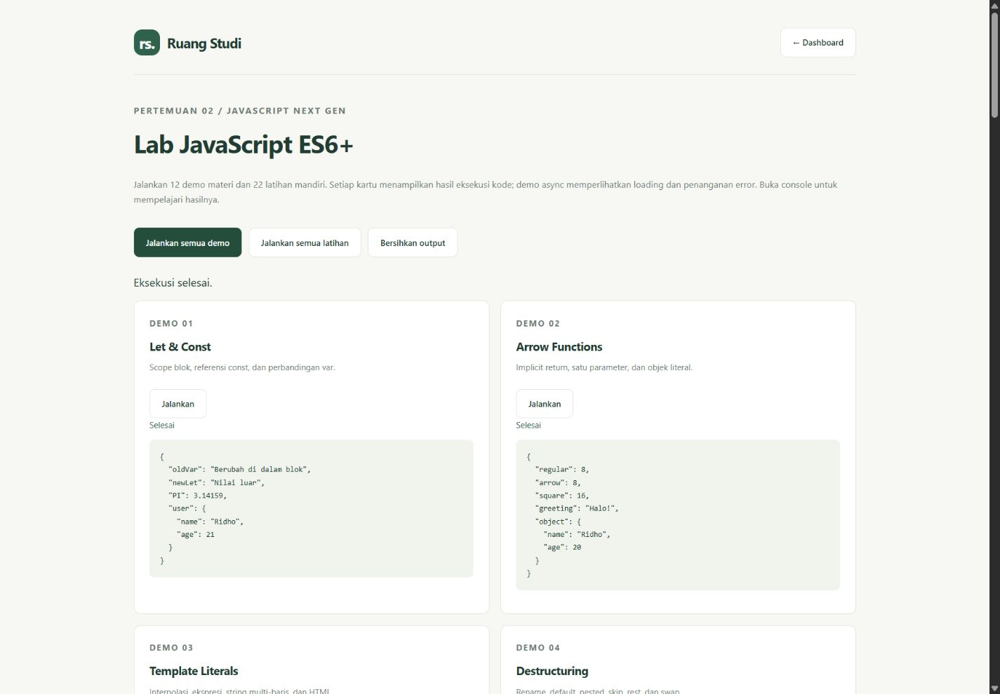

# Ruang Studi — Personal Dashboard Mahasiswa

**Ridho Maulana Saputra · 124140090 · Kelas RA · Teknik Informatika ITERA**

Tugas Praktikum PAW Pertemuan 2: JavaScript Next Gen (ES6+).

## Deskripsi

Ruang Studi membantu mahasiswa mengelola tugas kuliah dalam satu dashboard. Setiap tugas memiliki mata kuliah, deadline, prioritas, catatan, dan status selesai. Ringkasan dan progres dihitung otomatis. Widget cuaca menampilkan kondisi sekitar kampus ITERA melalui Open-Meteo.

HTML, CSS, dan JavaScript dipisahkan. Aplikasi menggunakan ES Modules tanpa framework, database, build, atau instalasi dependency.

## Menjalankan

1. Buka folder proyek di VS Code.
2. Klik kanan `index.html` dalam folder Pertemuan 2, pilih **Open with Live Server**.
3. Klik **Tambah tugas** atau **Gunakan data contoh** untuk mencoba aplikasi.
4. Buka **Lab JavaScript** untuk demo dan solusi latihan modul.

Gunakan HTTP melalui Live Server, bukan membuka file dengan double-click (`file://`), karena browser membatasi import ES Modules. Internet diperlukan hanya untuk widget cuaca; daftar tugas dan latihan tetap berfungsi tanpa internet. Data contoh menggunakan tanggal praktikum Oktober 2026 dan dimasukkan hanya ketika pengguna menekan tombolnya.

## Fitur

- [x] Tambah dan edit nama tugas, mata kuliah, deadline, prioritas, dan catatan.
- [x] Hapus tugas melalui dialog konfirmasi; tombol Batal menjadi fokus awal.
- [x] Tandai tugas selesai atau belum selesai.
- [x] Pencarian berdasarkan nama tugas dan mata kuliah, tanpa membedakan huruf besar/kecil.
- [x] Filter Semua / Belum selesai / Selesai.
- [x] Urutkan berdasarkan deadline, prioritas, atau waktu penambahan.
- [x] Ringkasan total, belum selesai, selesai, dan terlambat.
- [x] Progress bar dan persentase penyelesaian.
- [x] Deadline berikutnya, termasuk informasi tugas yang terlambat.
- [x] localStorage; data tetap ada setelah refresh.
- [x] Validasi tanggal kalender dan panjang input; karakter HTML pada input di-escape.
- [x] Cuaca Open-Meteo menggunakan async/await, indikator loading, timeout 10 detik, pesan error, dan tombol coba lagi.
- [x] Layout responsif, label input, navigasi keyboard, focus indicator, dan dialog native.
- [x] Lab dengan 12 demo dan 22 solusi latihan mandiri.

## Penerapan ES6+ dan lokasi kode

Nomor baris mengacu pada file sumber di folder ini.

| Fitur | Lokasi | Penggunaan |
| --- | --- | --- |
| `let` dan `const` | `js/main.js:5`, `js/main.js:6`, `js/main.js:8` | Referensi DOM tetap; aplikasi dan filter dapat berubah |
| Arrow function 1 | `js/modules/utils.js:1` | `escapeHtml` untuk input pengguna |
| Arrow function 2 | `js/modules/utils.js:2` | `todayKey` untuk tanggal WIB |
| Arrow function 3 | `js/modules/utils.js:3` | `formatDate` untuk tanggal Indonesia |
| Arrow functions tambahan | `js/main.js:11`, `js/main.js:12` | Notifikasi dan renderer tugas |
| Template literals | `js/main.js:12` | Rendering dinamis kartu tugas |
| Async/await dan fetch | `js/app.js:34`, `js/main.js:66` | Mengambil data cuaca dan memperbarui UI |
| `try/catch/finally` | `js/app.js:37`, `js/main.js:68` | Error jaringan, timeout, dan pembersihan loading |
| Class `TaskItem` | `js/modules/task-item.js:3` | Model, validasi, getter terlambat, salinan perubahan |
| Class `DashboardApp` | `js/app.js:4` | State, CRUD, localStorage, pencarian, dan API |
| Destructuring parameter | `js/modules/task-item.js:4`, `js/main.js:12` | Mengambil properti tugas |
| Destructuring respons API | `js/app.js:40` | Mengambil `current_weather` |
| Spread array/objek | `js/app.js:23`, `js/modules/task-item.js:14` | Array baru saat tambah, objek baru saat edit |
| `map`, `filter`, `find`, `reduce`, `some` | `js/app.js:24`, `js/app.js:25`, `js/app.js:27`, `js/main.js:32` | Edit/hapus, ringkasan, validasi keberadaan, deadline |
| Default parameters | `js/app.js:28`, `js/modules/task-item.js:4` | Nilai awal filter dan model |
| ES Modules | `index.html:8`, `js/main.js:1` | `type="module"`, import/export |

Promise, rest parameters, inheritance, enhanced object literals, dan advanced arrays juga dipraktikkan di [Lab JavaScript](modul/README.md).

## Pengelolaan data

Kunci penyimpanan adalah `ruang-studi-124140090-v1`. Array instance `TaskItem` diserialisasi dengan `JSON.stringify()` dan dibaca dengan `JSON.parse()`, lalu direkonstruksi sebagai instance agar getter dan method tetap tersedia.

Setiap perubahan disimpan sebelum state di memori diperbarui. Jika browser menolak penyimpanan, aplikasi menampilkan pesan dan mempertahankan state sebelumnya. Data lokal rusak tidak ditimpa diam-diam; aplikasi meminta pengguna memeriksa penyimpanan browser. ID tugas memakai `crypto.randomUUID()` yang didukung pada localhost/HTTPS.

Data tersimpan hanya di browser dan origin yang sama. Mengganti hostname/port atau menghapus data browser membuat penyimpanan berbeda/hilang. Cuaca tidak disimpan sebagai data tugas. Tanggal dan hitungan deadline mengikuti WIB; deadline berlaku untuk satu tanggal, tanpa jam.

## Struktur

```text
ridhomaulanasaputra_124140090_pertemuan2/
├── index.html
├── README.md
├── css/style.css
├── js/
│   ├── main.js
│   ├── app.js
│   └── modules/
│       ├── task-item.js
│       ├── utils.js
│       └── data.js
├── modul/
│   ├── index.html
│   ├── README.md
│   └── js/
│       ├── main.js
│       ├── demos.js
│       ├── exercises.js
│       └── modules/{data.js,utils.js}
├── screenshots/
└── tests/app.test.mjs
```

## Pengujian

Jalankan dari root repository menggunakan Node.js modern (pengujian dilakukan dengan Node 22+):

```sh
node --test ridhomaulanasaputra_124140090_pertemuan2/tests/app.test.mjs
```

Enam skenario lulus: CRUD/persistensi/filter/urut, validasi input, kegagalan penyimpanan, data lokal rusak, respons/error/timeout API, serta seluruh demo/latihan dan retry.

Pengujian browser mencakup tambah tugas, form kosong, edit, selesai, refresh, pencarian, filter, urutan prioritas, konfirmasi hapus, API cuaca nyata, 12 demo, 22 latihan, dan layout ponsel 390 piksel tanpa overflow horizontal. Error cuaca diuji menggunakan respons simulasi pada pengujian otomatis.

## Screenshot

### Dashboard



### Validasi input



### Edit tugas



### Tampilan ponsel



### Lab JavaScript



## Acuan pengumpulan

Repository: `pemrograman_web_itera_124140090`. Folder ini berisi tugas dan praktikum Pertemuan 2. Deadline pada PDF modul: Sabtu, 17 Oktober 2026 pukul 23.59 WIB. Untuk tautan pengumpulan kelas RA, ikuti informasi asprak.
