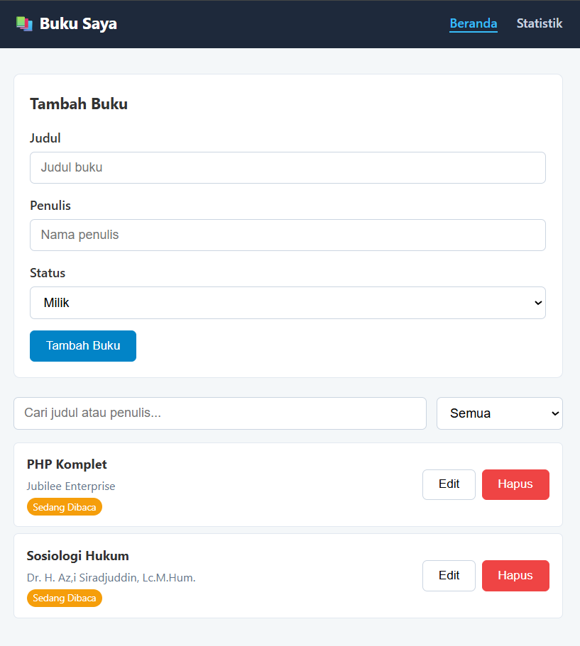
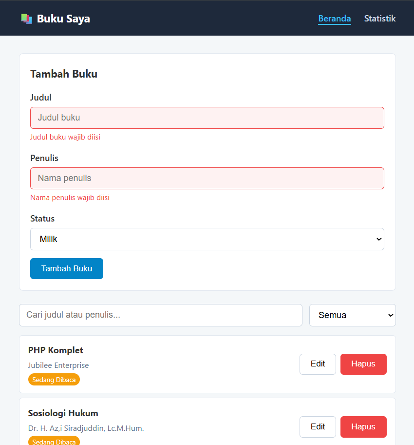
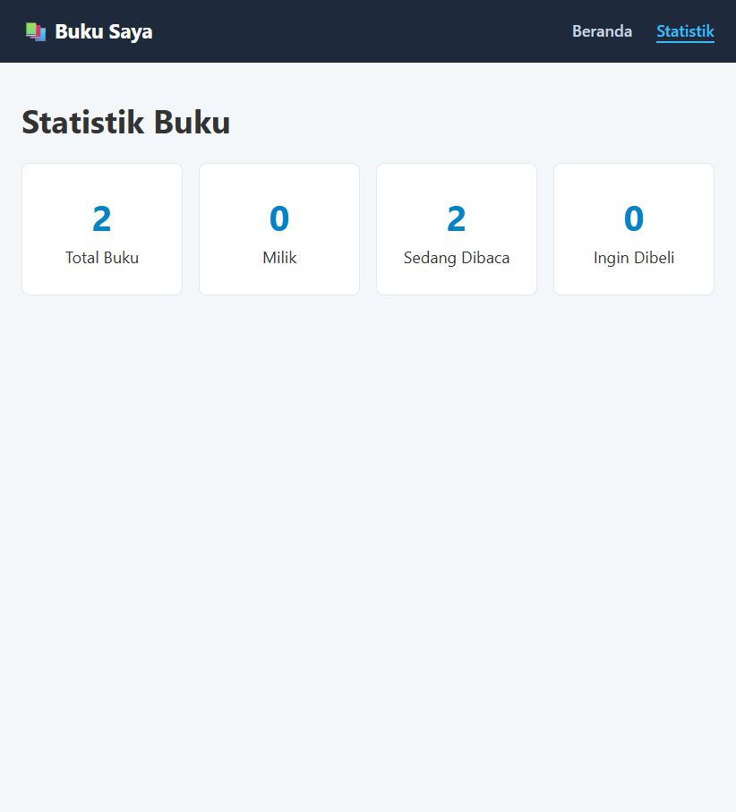
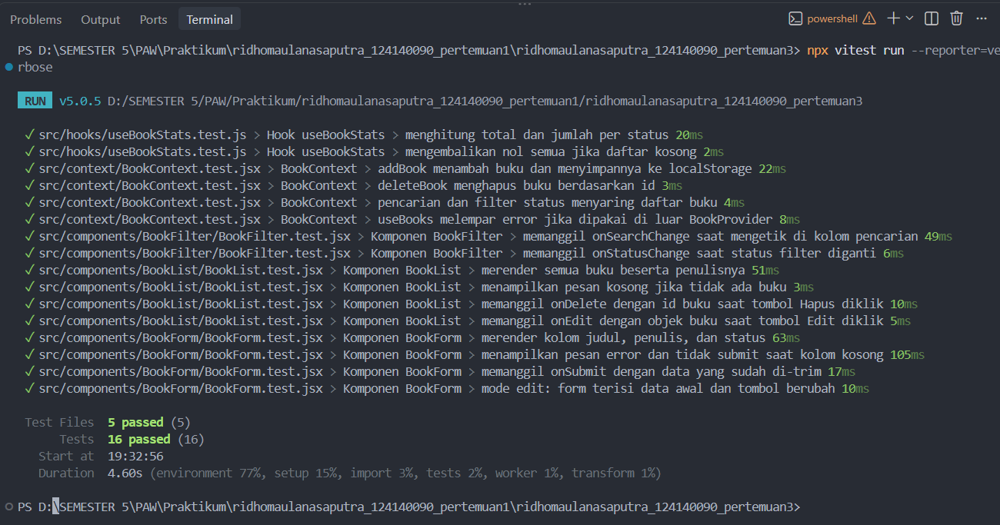

# Aplikasi Manajemen Buku Pribadi

Aplikasi web untuk mencatat buku yang dimiliki, sedang dibaca, atau ingin dibeli.
Dibuat dengan React + Vite untuk Praktikum Pengembangan Aplikasi Web Pertemuan 3.

**Nama:** Ridho Maulana Saputra  
**NIM:** 124140090
**Kelas:** RA

## Fitur
- Tambah buku (judul, penulis, status: Milik / Sedang Dibaca / Ingin Dibeli)
- Edit dan hapus buku (dengan konfirmasi hapus)
- Filter berdasarkan status
- Pencarian berdasarkan judul atau penulis
- Halaman statistik jumlah buku per status
- Validasi form dengan feedback visual
- Data tersimpan permanen di localStorage

## Cara Menjalankan
Prasyarat: Node.js v18 atau lebih baru.

```bash
npm install
npm run dev
```
Buka alamat yang tampil di terminal (biasanya http://localhost:5173).

Menjalankan unit test:
```bash
npm test
```

## Screenshot
| Beranda | Validasi Form | Statistik |
|---|---|---|
|  |  |  |

## Fitur React yang Digunakan
| Konsep | Penerapan |
|---|---|
| `useState` | State form, filter, pencarian, dan buku yang diedit |
| `useEffect` | Sinkronisasi data ke localStorage di `useLocalStorage` |
| `useMemo` | Menyaring buku dan menghitung statistik hanya saat data berubah |
| `useContext` + Context API | `BookContext` menyediakan data dan fungsi CRUD ke seluruh halaman |
| Custom Hooks | `useLocalStorage` (persistensi) dan `useBookStats` (statistik) |
| React Router | Navigasi `/` (Beranda) dan `/stats` (Statistik) tanpa reload |
| PropTypes | Type checking pada semua komponen |
| Reusable Components | `BookForm`, `BookList`, `BookFilter`, `Navbar` |
| Controlled Components | Seluruh input form dikontrol lewat state |

## Struktur Folder
```
Ridho_124140090_pertemuan3/
├── public/
├── screenshots/                    # Gambar untuk README
│   ├── home.png
│   ├── form-error.png
│   ├── stats.png
│   └── test-result.png
├── src/
│   ├── components/
│   │   ├── BookForm/
│   │   │   ├── BookForm.jsx
│   │   │   ├── BookForm.css
│   │   │   └── BookForm.test.jsx
│   │   ├── BookList/
│   │   │   ├── BookList.jsx
│   │   │   ├── BookList.css
│   │   │   └── BookList.test.jsx
│   │   ├── BookFilter/
│   │   │   ├── BookFilter.jsx
│   │   │   ├── BookFilter.css
│   │   │   └── BookFilter.test.jsx
│   │   └── Navbar/
│   │       ├── Navbar.jsx
│   │       └── Navbar.css
│   ├── pages/
│   │   ├── Home/
│   │   │   ├── Home.jsx
│   │   │   └── Home.css
│   │   └── Stats/
│   │       ├── Stats.jsx
│   │       └── Stats.css
│   ├── hooks/
│   │   ├── useLocalStorage.js
│   │   ├── useBookStats.js
│   │   └── useBookStats.test.js
│   ├── context/
│   │   ├── BookContext.jsx
│   │   └── BookContext.test.jsx
│   ├── App.jsx
│   ├── App.css
│   ├── main.jsx
│   ├── index.css
│   └── setupTests.js
├── index.html
├── package.json
├── vite.config.js
└── README.md
```

### Penjelasan Tiap Bagian

| Lokasi | Peran |
|---|---|
| `components/BookForm` | Form tambah/edit buku dengan validasi kolom wajib isi dan feedback visual |
| `components/BookList` | Daftar buku, badge status, serta tombol Edit dan Hapus |
| `components/BookFilter` | Kolom pencarian (judul/penulis) dan dropdown filter status |
| `components/Navbar` | Navigasi antar halaman dengan `NavLink` |
| `pages/Home` | Halaman utama: menyambungkan context ke form, filter, dan daftar buku |
| `pages/Stats` | Halaman statistik jumlah buku per status |
| `hooks/useLocalStorage.js` | Custom hook: state yang otomatis tersinkron dengan localStorage |
| `hooks/useBookStats.js` | Custom hook: menghitung total dan jumlah buku per status |
| `context/BookContext.jsx` | Context API: sumber data tunggal (buku, CRUD, filter, pencarian, statistik) |
| `App.jsx` | Root aplikasi: `Router`, `BookProvider`, dan definisi rute |
| `main.jsx` | Titik masuk yang me-render `App` ke DOM |
| `setupTests.js` | Setup `jest-dom` untuk Vitest |
| `*.test.jsx` / `*.test.js` | Unit test (16 test case) yang diletakkan di samping file yang diuji |

### Alur Data
```
localStorage ⇄ useLocalStorage ⇄ BookContext ──► Home ──► BookForm / BookFilter / BookList
                                      │
                                      └──► useBookStats ──► Stats
```
Komponen di `components/` hanya menerima data dan fungsi lewat props, sehingga reusable dan mudah dites. Hanya `pages/` dan `BookContext` yang tahu soal state global.

## Laporan Testing
16 test case di 5 file (React Testing Library + Vitest), seluruhnya lolos.


