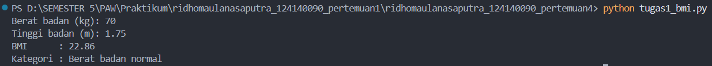
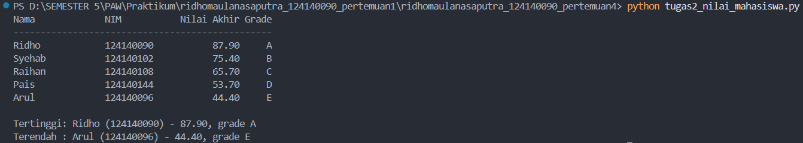
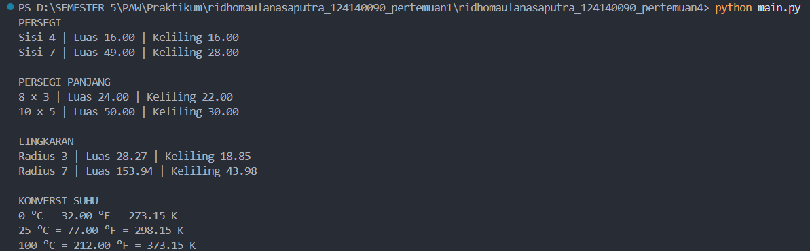

# Praktikum PAW ITERA — Pertemuan 4: Python Dasar

- **Nama** — Ridho Maulana Saputra
- **NIM** — `124140090`

## Cara menjalankan

1. Buka folder pertemuan di VS Code, lalu pilih **Terminal → New Terminal**.
2. Cek Python dengan `python --version`. Jika di Windows hanya `py --version` yang berhasil, gunakan `py` sebagai pengganti `python`.
3. Jalankan perintah di bawah dari folder pertemuan. Semua program memakai pustaka bawaan Python.

## Latihan mandiri

| Latihan | Perintah | Yang dipraktikkan |
| --- | --- | --- |
| 1. Kartu identitas | `python latihan/latihan1.py` | Menampilkan profil dengan `print()`, pemisah `sep`, dan baris baru `\n`. |
| 2. Konversi suhu | `python latihan/latihan2_suhu.py` | Membaca suhu Celsius, menghitung Fahrenheit dan Kelvin, lalu memformat hasil dengan dua desimal. |
| 3. Tebak angka | `python latihan/latihan3_tebak.py` | Mengulang input dengan `while`, memberi petunjuk lewat percabangan, dan berhenti dengan `break`. |
| 4. Validasi password | `python latihan/latihan4_validasi.py` | Menguji fungsi `validasi_password()` dengan syarat minimal delapan karakter dan satu angka. |
| 5. Katalog kontak | `python latihan/latihan5_kontak.py` | Menambah dan menampilkan kontak dalam dictionary, serta mencari nomor dengan `.get()`. |
| 6. Generator password | `python latihan/main.py` | Mengimpor `buat_password_acak()` dari `latihan/password_gen.py` dan menguji panjang 8 dan 12 karakter. |

## Tugas praktikum

### Soal 1 — Penghitung BMI

```bash
python tugas1_bmi.py
```

Program membaca berat badan dalam kilogram dan tinggi badan dalam meter, lalu menghitung BMI dengan rumus `berat / (tinggi * tinggi)`. Percabangan menentukan kategori berdasarkan ambang 18,5, 25, dan 30. Hasil ditampilkan dengan dua desimal.

Contoh uji dengan berat `70` kg dan tinggi `1.75` m menghasilkan BMI `22.86` dengan kategori **Berat badan normal**.



### Soal 2 — Pengelolaan nilai mahasiswa

```bash
python tugas2_nilai_mahasiswa.py
```

Data lima mahasiswa disimpan sebagai list berisi dictionary. Fungsi `hitung_nilai_akhir()` menghitung nilai dengan bobot UTS 30%, UAS 40%, dan tugas 30%. Fungsi `tentukan_grade()` menggunakan ambang 80, 70, 60, dan 50 untuk menghasilkan grade A hingga E. Program mencetak tabel nama, NIM, nilai akhir, dan grade. Fungsi `max()` dan `min()` mencari mahasiswa dengan nilai akhir tertinggi dan terendah.



### Soal 3 — Modul matematika

```bash
python main.py
```

`math_operations.py` mendefinisikan konstanta `PI` dan delapan fungsi berikut.

| Fungsi | Hasil |
| --- | --- |
| `luas_persegi()`, `keliling_persegi()` | Luas dan keliling dari panjang sisi. |
| `luas_persegi_panjang()`, `keliling_persegi_panjang()` | Luas dan keliling dari panjang dan lebar. |
| `luas_lingkaran()`, `keliling_lingkaran()` | Luas dan keliling dari jari-jari dengan konstanta `PI`. |
| `celsius_ke_fahrenheit()`, `celsius_ke_kelvin()` | Suhu Fahrenheit dan Kelvin dari suhu Celsius. |

`main.py` memakai `import math_operations` untuk fungsi geometri dan `from math_operations import ...` untuk fungsi konversi suhu. Program menjalankan semua fungsi dengan beberapa nilai uji dan menampilkan hasilnya dengan dua desimal.


