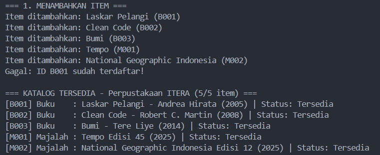
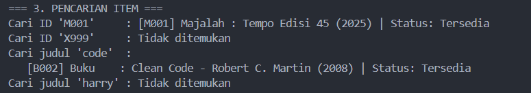
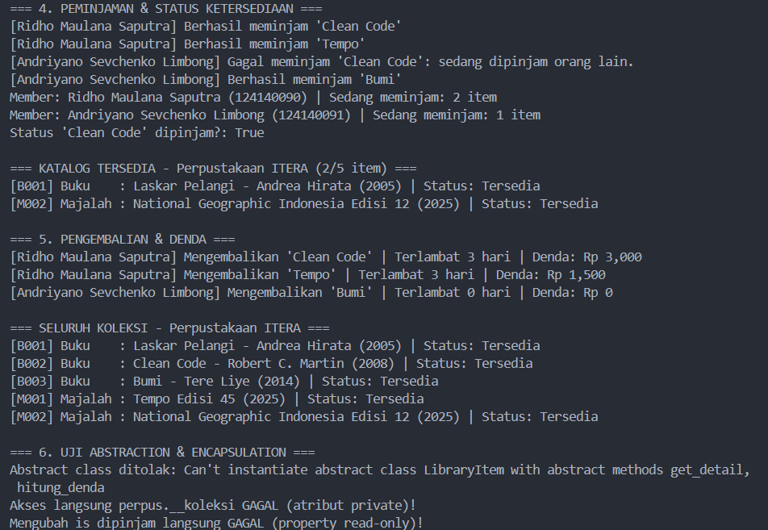

# Praktikum PAW ITERA — Pertemuan 5: Python OOP

- **Nama** — Ridho Maulana Saputra
- **NIM** — `124140090`
- **Kelas Praktikum** — RA

## Cara menjalankan

1. Buka folder pertemuan di VS Code, lalu pilih **Terminal → New Terminal**.
2. Cek Python dengan `python --version`. Jika di Windows hanya `py --version` yang berhasil, gunakan `py` sebagai pengganti `python`.
3. Jalankan perintah di bawah dari folder pertemuan. Semua program memakai pustaka bawaan Python.

## Latihan (hands-on modul)

| Latihan | Perintah | Yang dipraktikkan |
| --- | --- | --- |
| Everything is object | `python latihan/01_everything_is_object.py` | Melihat class di balik nilai bawaan dengan `type()`, `__class__`, dan `id()`. |
| Prosedural vs OOP | `python latihan/01_procedural_vs_oop.py` | Membandingkan data mahasiswa dalam dictionary dan fungsi terpisah dengan class `Mahasiswa`. |
| Class & object | `python latihan/02_class_object.py` | Atribut class dan instance, method, serta `__str__` dan `__repr__`. |
| Inheritance | `python latihan/03_inheritance.py` | Subclass `Mobil`, `Motor`, dan `MobilListrik`, `super()`, overriding, multiple inheritance, dan MRO. |
| Encapsulation | `python latihan/04_encapsulation.py` | Atribut public, protected, dan private pada `RekeningBank`, `@property` setter, dan name mangling. |
| Polymorphism | `python latihan/05_polymorphism.py` | Metode pembayaran dengan `bayar()` yang seragam, duck typing, dan operator overloading `__add__` dan `__eq__`. |
| Abstract class | `python latihan/06_abstract_class.py` | `ABC` dan `@abstractmethod` pada `Shape` dan `DatabaseConnector`. |

## Latihan mandiri

| Latihan | Perintah | Yang dipraktikkan |
| --- | --- | --- |
| 1. Sistem kasir toko | `python latihan/mandiri/latihan_toko.py` | Pemodelan entitas `Produk`, `Pengguna`, dan `Keranjang`, masing-masing dengan atribut dan method. |
| 2. Class buku | `python latihan/mandiri/latihan_buku.py` | `hitung_harga_diskon()`, kartu buku lewat `__str__`, dan jumlah halaman lewat `__len__`. |
| 3. Truk ekspedisi | `python latihan/mandiri/latihan_truk.py` | Subclass `Truk(Kendaraan)` dengan validasi kapasitas di `muat_barang()` dan override `deskripsi()`. |
| 4. Penggajian karyawan | `python latihan/mandiri/latihan_karyawan.py` | Atribut private `__gaji_pokok` dengan setter yang menolak gaji di bawah UMR Rp 3.200.000, serta `hitung_gaji_bersih()`. |
| 5. Notifikasi | `python latihan/mandiri/latihan_notifikasi.py` | Kelas email, SMS, dan WhatsApp dengan `kirim()` yang dipanggil seragam oleh `broadcast_pengumuman()`. |
| 6. File storage | `python latihan/mandiri/latihan_storage.py` | Abstract class `FileStorage` dengan implementasi `LocalDiskStorage` dan `CloudStorage`. |

## Tugas praktikum — Sistem Manajemen Perpustakaan

```bash
cd tugas_perpustakaan
python main.py
```

### Struktur berkas

| Berkas | Isi |
| --- | --- |
| `library_item.py` | Abstract class `LibraryItem` serta subclass `Book` dan `Magazine`. |
| `library.py` | Class `Library` yang menyimpan koleksi di atribut private `__koleksi`. |
| `member.py` | Class `Member` untuk meminjam dan mengembalikan item. |
| `main.py` | Skrip yang menguji seluruh fitur. |

### Alur program

`main.py` membuat objek `Library`, lalu menambahkan tiga buku dan dua majalah. Item dengan ID yang sudah terdaftar ditolak. Program kemudian menampilkan katalog item yang tersedia dan mencari item berdasarkan ID dan judul. Pencarian judul tidak membedakan huruf besar dan kecil.

Setelah itu dua anggota meminjam item. Item yang sedang dipinjam tidak bisa dipinjam orang lain dan hilang dari katalog tersedia. Saat item dikembalikan, program menghitung denda keterlambatan. Bagian terakhir membuktikan bahwa abstract class tidak bisa diinstansiasi dan atribut yang dilindungi tidak bisa diakses dari luar.

### Penerapan pilar OOP

| Pilar | Penerapan |
| --- | --- |
| Class & object | `LibraryItem`, `Book`, `Magazine`, `Library`, dan `Member` menjadi cetak biru. `main.py` membuat objek nyata dari class tersebut. |
| Inheritance & abstraction | `Book` dan `Magazine` mewarisi `LibraryItem(ABC)`, memakai `super().__init__()`, dan wajib mengimplementasikan `get_detail()` serta `hitung_denda()`. |
| Encapsulation | Atribut protected (`_judul`, `_item_id`) dan private (`__dipinjam`, `__koleksi`, `__nim`, `__pinjaman`). Data dibaca lewat `@property` read-only seperti `is_dipinjam`, `judul`, dan `jumlah_item`. Status pinjam hanya berubah lewat method `pinjam()` dan `kembalikan()`. |
| Polymorphism | `Library` dan `Member` memanggil `get_detail()` dan `hitung_denda()` tanpa memeriksa jenis item. Buku dikenai denda Rp 1.000 per hari, sedangkan majalah Rp 500 per hari. |

### Screenshot output






